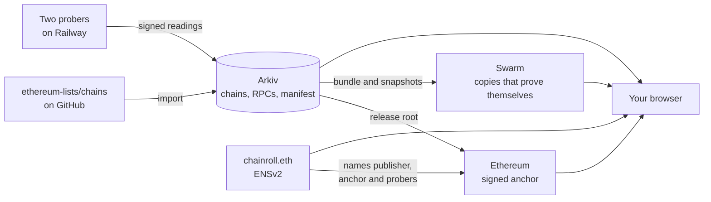
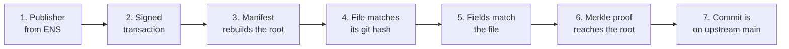
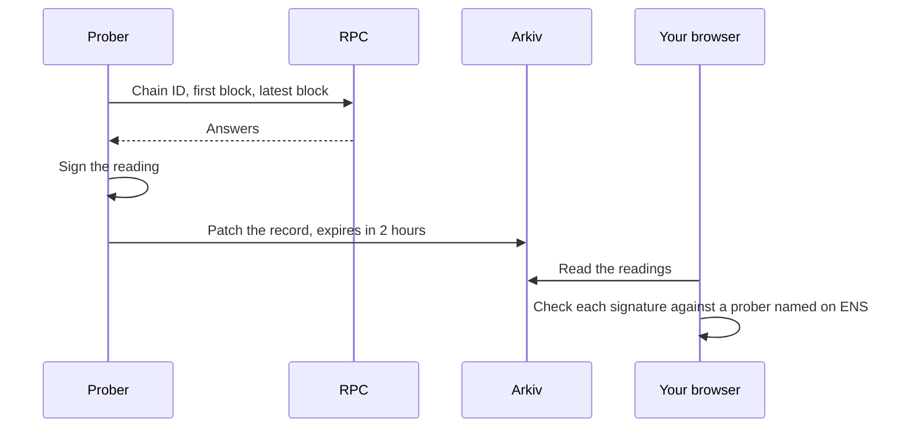

# Chainroll

**Is this the real chain? Does this RPC work?**

Wallets add networks from a list of JSON files on GitHub. The list can't tell you which RPCs still work, or prove a record
wasn't changed. Chainroll mirrors all 2,855 chains to Arkiv, signs them, and adds live evidence for every RPC it probes.

**Live site:** [chainroll-flame.vercel.app](https://chainroll-flame.vercel.app). It is static files: your browser reads Arkiv,
Ethereum and Swarm directly, so nothing passes through a server of ours.

Built at ETHGlobal Mumbai. The repo, CLI and Arkiv records keep the technical name `chainkiv`.

| Measured | Result |
|---|---|
| Chains mirrored and verified | 2,855 of 2,855 |
| Records on Arkiv | 9,610, plus 2,848 Chainlist RPC URLs |
| RPCs probed every 20 minutes | 958, from two regions, each reading signed |
| Upstream commits behind | 0 on 7 Nov 2026 |
| Release and probe history on Swarm | [Release 1](https://api.gateway.ethswarm.org/bzz/02dfe3be9574facc326ca63a62bede88a8a8a06acd5bbe223db05714f943f65b/), [1,916 readings](https://api.gateway.ethswarm.org/bzz/bb1c98a038775d7ebe17f33942777ea7f3898c8653ceeddbbc3b0578abb2692d/) |

## How it works



## How one record is verified

These seven checks run in your browser. If one byte of a record changes, the path breaks at that step.



## How one RPC is measured



## What it adds to a flat list

- **Queries:** find a chain by ID, short name, parent, currency or red flag, with no API key.
- **Proof:** check a record against the exact upstream file and a signed release.
- **Live RPC evidence:** see which listed RPCs answer correctly right now.
- **Privacy labels:** see what Chainlist reports about whether an RPC tracks you.
- **Copies on Swarm:** a release and the probers' history that outlive a testnet, and prove themselves.
- **Add to wallet:** add a network with only the RPCs that passed.

**In V1 the publisher is this team, not the EthereumLists maintainers.** The signature proves who published this copy
and what it contains. It does not mean the maintainers approved it.

## Requirements

- [Bun](https://bun.sh) 1.3 or later
- An access key from [hub.arkiv.network](https://hub.arkiv.network) for imports
- A funded Rabdi wallet for writes; reads need neither

## Quick start

```bash
bun install
cp .env.example .env.local
bun run cli doctor
```

Rebuild the release root for a commit, with no wallet:

```bash
bun run cli import --commit e17474286275730fb6b0490b1d7ea1c64a36ed9e --root-only
```

Test every listed RPC, read-only, with no wallet:

```bash
bun run cli survey
```

Query Rabdi:

```bash
bun run cli query "arkiv.schema = str('chainkiv.chain') AND chainId = u64(8453) AND \$owner = addr(0xb6d7BE32085f47D07dE996e2dA8F7664408fA304)"
```

Run the import again. At the same commit it changes nothing:

```bash
bun run cli import --commit e17474286275730fb6b0490b1d7ea1c64a36ed9e --dry-run
```

## Wallets on Rabdi

| Role | Address |
|---|---|
| Publisher | `0xb6d7BE32085f47D07dE996e2dA8F7664408fA304` |
| Prober A | `0xecDEfDB69daF7De91615adf1D7bb955AA0D5a521` |
| Prober B | `0x6eEAaa1835b82A8ecbF11BAa9c109FE009534d17` |
| Validator | `0x06B38cA11785e6b75B489F642683216a2eA55df3` |

## How to check the publisher

The publisher is named by `chainroll.eth` on Sepolia, in the text records `arkiv.publisher`, `arkiv.chainId`,
`arkiv.latestAnchor`, `arkiv.root`, `arkiv.release`, `arkiv.metaHash` and `arkiv.probers`. Verify fails if the root on ENS
differs from the anchor. It is a testnet name, and ENS warns that Sepolia names may be reset.

ENSv2 does more than store these records:

- **Probers are subnames.** `chainroll.eth` has its own registry, `probers.chainroll.eth` has another, and each prober is
  `a.probers.chainroll.eth`, with its own resolver. A prober can write its text records but not the address that identifies
  it. Apps read the list from ENS, so a prober can be added or removed without a new release.
- **Keys can be limited.** `chainkiv ens-handover --to <address> --confirm chainroll.eth` moves the name to a cold wallet or
  multisig and leaves the hot key only the four release records. A stolen hot key cannot take the name.
  [`spike/ens-roles-test.ts`](spike/ens-roles-test.ts) proves this on a throwaway name.

`chainroll.eth` itself has **not** been handed over. It is still held by the publisher key, and that key is ours.

```bash
bun run cli verify 8453
bun run cli verify --all
bun run cli verify --chainlist
```

## Probers

The two probers run on Railway from the `Dockerfile`, Prober A in Southeast Asia and Prober B in US West. Each wallet
must run in exactly one place, because two copies of one prober collide on nonces.

## Swarm

Each release is packed into a bundle, uploaded through a Bee node, read back through a public gateway and checked against the
signed root. Only then is its reference recorded on Arkiv. Probe snapshots work the same way, and every reading keeps its
signature. Details are in [arkiv/swarm.md](arkiv/swarm.md).

```bash
bun run cli swarm-stamp --days 7
bun run cli swarm-save
bun run cli swarm-archive
```

## Data sources and licences

The code in this repo is under the [MIT licence](LICENSE). The data keeps the licence of its source.

| Data | Source | Licence | How we use it |
|---|---|---|---|
| Chain records, RPCs and explorers | [ethereum-lists/chains](https://github.com/ethereum-lists/chains) | [MIT](https://github.com/ethereum-lists/chains/blob/master/LICENSE), which allows republishing | Mirrored to Arkiv; the original file is kept byte for byte in `raw` |
| Extra RPCs, tracking labels and privacy statements | [DefiLlama/chainlist](https://github.com/DefiLlama/chainlist), the data behind [chainlist.org](https://chainlist.org) | [GPL-3.0](licenses/GPL-3.0.txt), which allows republishing with credit and the same licence | Split into one record per RPC and one per privacy statement |

**Credit:** the RPC tracking labels and privacy statements are the work of the DefiLlama Chainlist contributors and the
RPC providers who wrote them.

**The Chainlist data on Arkiv stays under GPL-3.0.** Every `chainkiv.rpcPrivacy` and `chainkiv.privacyPolicy` entity
records `source`, `sourceCommit` and `licence`. Our only change is the format: we split the list into separate records,
and the text of each statement is unchanged. Chainlist's data files are not in this repo, and none of its code is used:
`src/chainlist.ts` reads the file as plain data and never runs it.

**Tracking labels are reported, not checked.** They come from Chainlist and the providers. ChainKiv tests whether an RPC
answers correctly; it cannot test what a provider does with your requests.

## How we used AI

Claude Code wrote most of the code and docs from the team's PRD and decisions, and ran the tests and surveys. The team
chose the idea, reviewed the trust design, funded the wallets and made the outward-facing decisions.

## More

- [arkiv/why-arkiv.md](arkiv/why-arkiv.md): what people would lose without Arkiv, and why not GitHub, Postgres or IPFS
- [arkiv/reach.md](arkiv/reach.md): who depends on the list, and who would use this copy
- [arkiv/data-quality.md](arkiv/data-quality.md): how current it is, how it stays that way, and how people can filter it
- [arkiv/friction.md](arkiv/friction.md): 14 rough edges, with steps to reproduce
- [arkiv/schema.md](arkiv/schema.md): entities, owners and expiry
- [arkiv/swarm.md](arkiv/swarm.md): how Arkiv and Swarm work together
- [PRD.md](PRD.md): the full plan
